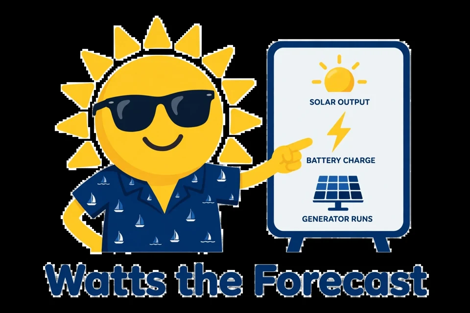

# Watts the Forecast



*(internal name: `solardash` — the Python package, Docker image and Home Assistant entity ids keep that name)*

Local, self-hosted monitoring and control for an **off-grid cabin** built from an **EG4 6000XP**,
**Eco-Worthy 48V 100Ah server-rack batteries** (JBD BMS), an **EG4 Chargeverter GC** and Honda
EU3000is generators – a replacement for Solar Assistant that runs in Docker on a NAS or on a
Raspberry Pi. There is no grid anywhere in the data model; the generators feed the battery through the
Chargeverter.

* Live dashboard (power flow, SOC, per-cell battery view, inverter details) with history charts
* Generator tracking for the Hondas that feed the Chargeverter: pick which one is on the cam switch in
  the UI, and solardash logs start/stop events and run hours per generator (per day and lifetime)
* Reads the inverter over Modbus RTU (RS485) and each battery over the JBD protocol – no cloud
* Inverter settings read/write with range checks and confirmation for risky ones (opt-in)
* Chargeverter output inferred from BMS pack power minus inverter battery power (no wiring to it
  needed; an optional RS485 link can sniff or answer its battery polls)
* Hourly solar irradiance forecast from Open-Meteo (free, no key) plus the cabin's own Weather
  Underground station for measured conditions
* PV forecast model that learns the array's clear-sky capacity from history and self-corrects against
  what the forecast predicted; load profiles learned per occupancy mode (occupied / away)
* Generator planner that minimises fuel and engine wear: simulates SOC 72 h ahead and recommends when to
  start and how long to run — fewer, longer runs, as late as is safe, never charging what the sun will
  cover; exposed on the API and MQTT for Home Assistant to act on
* Snow detection: compares the array's output with the sunlight Open-Meteo estimated for the cabin
  (ignoring hours with a full battery); covered panels cut the solar forecast so the generator plan
  stops counting on sun the array can't use, until the panels produce again or "Panels cleared" is pressed
* Fuel and oil tracking per generator: tank level from engine hours, refill warnings in the plan,
  oil-change countdown, "Tank refilled" / "Oil changed" buttons in the app and in Home Assistant
* Scorecard: starts, run hours, kWh per hour, share of run at full current, hours at the floor and
  curtailed solar per day, so the strategy can be judged on data
* SQLite history with hourly rollups; MQTT output using Solar Assistant's topic names plus
  Home Assistant discovery
* Simulation mode and a serial probe tool, so you can try everything before touching hardware

See [docs/DESIGN.md](docs/DESIGN.md) for protocol details, wiring and architecture, and
[docs/HOME_ASSISTANT.md](docs/HOME_ASSISTANT.md) for the Home Assistant side.

**On an iPhone:** open the dashboard in Safari, tap Share → *Add to Home Screen*. It installs as a
full-screen app (dark or light with the system setting, bottom tab bar, safe-area aware) and
reconnects to the live feed whenever it is brought to the front.

## Quick start (no hardware)

```bash
pip install -e .[dev]
solardash serve --simulate --port 8080
```

Open http://localhost:8080.

## Install on a Synology (Container Manager, nothing else)

1. **File Station:** create a folder, for example `docker/solardash`, and put one file in it:
   [`docker-compose.yml`](docker-compose.yml) from this repo (open it on GitHub, *Download raw file*).
   If you use Cloudflare Tunnel, open the file in a text editor and paste your tunnel token after
   `TUNNEL_TOKEN=`; if the tunnel already runs in its own container, delete that block.
2. **Container Manager → Project → Create:** name `solardash`, path = that folder, Start.
3. Open `http://<nas-ip>:8080` → **System** → **Setup**. Press *Scan ports*, pick the inverter's port
   and one port per battery (the Solar Assistant layout, inverter on `ttyACM0` and batteries on
   `ttyACM1`–`3`, is pre-filled), enter your coordinates, save. Weather key, planner limits,
   generators and MQTT live on the same page.

Stop the Solar Assistant container first: only one program can own a serial port. Everything you
set is stored in the `solardash-data` volume and survives updates.

**Updating:** Container Manager → **Image** → `ghcr.io/marvsmufflers/solardash` → *Update*, then
**Project** → `solardash` → *Action* → *Restart*. If the phone still shows the old look, delete the
pinned app and add it again (Safari caches it).

A `config.yaml` (see `config.example.yaml`) is optional for advanced setups; mount it at
`/app/config.yaml`. Setup-page values override it.

## Wiring summary

| Link | Connector | Pins | Serial |
|---|---|---|---|
| 6000XP | 4-pin dongle plug (black A / white B) or INV485 RJ45 | RJ45 pin 8 = A, pin 7 = B | 19200 8N1, unit 1 |
| Eco-Worthy pack | RS485-1 RJ45 (one adapter channel per pack) | pin 8 = A, pin 7 = B | 9600 8N1 |
| Chargeverter GC | BMS RJ45 | pin 2 = A, pin 1 = B | 9600 8N1, it is the master |

If a bus stays silent after checking pins and baud, swap the USB adapter: a dead adapter looks
exactly like wrong wiring.

## Configuration

Everything is in `config.yaml` (see `config.example.yaml`). Environment overrides:
`SOLARDASH_CONFIG`, `SOLARDASH_PORT`, `SOLARDASH_DB`, `SOLARDASH_LOG_LEVEL`, `SOLARDASH_SIMULATE`.

### Chargeverter

The Chargeverter is a dumb AC-to-DC charger in this system: Home Assistant starts the generator and
closes the contactor, so the charger's own start logic and SOC port are unused and nothing needs to be
wired to it. solardash infers its DC output as pack power (BMS) minus inverter battery power.
An RS485 link to its BMS RJ45 is optional (`chargeverter.mode`): `sniff` shows its SOC polls,
`emulate` answers them with real pack data so its display shows a SOC instead of *LOST*.

### Weather and generator planning

1. **Forecast source.** Open-Meteo is on by default and needs only `weather.latitude` /
   `weather.longitude` (or the Wunderground station's position). It supplies hourly global horizontal
   irradiance, which the PV model uses directly. Optionally add the Wunderground station: a PWS owner
   API key from wunderground.com/member/api-keys in `weather.api_key` (or `SOLARDASH_WU_API_KEY`) and
   `weather.station_id`; it adds measured solar radiation, temperature and the narrative forecast.
   `solardash probe weather` prints what the WU API returns.
2. **Model.** Starts from `planner.pv_kw_peak` (array size); after a few days of history it learns the
   array's real clear-sky capacity, the response to the station's measured irradiance, and a bias
   factor from forecast-vs-actual. Load profiles are learned by hour of day, separately for each
   occupancy mode; set the cabin's mode in the header dropdown, `PUT /api/occupancy`, or MQTT
   `<prefix>/occupancy/set` (a Home Assistant presence automation can do it).
3. **Planner.** Simulates SOC for `planner.horizon_h` hours. The Chargeverter fixes the generator's
   load, so each engine hour costs the same fuel and wear; the planner picks the stop point that needs
   the fewest engine hours, counting a start (`start_cost_h`) for every later run a shorter charge would
   cause and counting charge the sun would have replaced as wasted. Runs start as late as is safe,
   last `min_run_h`–`max_run_h` (one tank), never charge past `soc_ceiling`, and avoid quiet hours.
   While the generator runs it advises when to stop. The plan warns when the tank needs a refill first.
4. **Scorecard.** `/api/scorecard` and the Forecast tab show per day: starts, run hours, kWh delivered,
   kWh per hour, share of run time at full current, hours at the floor, and curtailed solar.

The plan is published on MQTT as `solar_assistant/plan/recommended_now`, `plan/stop_recommended`,
`plan/start_at`, `plan/end_at`, `plan/run_h`, `plan/end_soc`, `plan/reason` and the forecast as
`forecast/pv_today_kwh`, `forecast/pv_tomorrow_kwh`. A Home Assistant automation can start the
outhouse generator when `recommended_now` turns on (then do its 90 s warm-up and close the contactor)
and stop it when `stop_recommended` turns on. solardash itself never switches anything.

## Home Assistant and the auto-start generator

The outhouse generator's 12 V run signal (Waveshare Modbus relay in Home Assistant) is the best
"running" source there is, so solardash takes it from HA and uses it for that generator's run hours
and for a "warming up" state until the contactor closes. Either publish it over MQTT (retained) with
an automation like this:

```yaml
automation:
  - alias: solardash generator signal
    trigger:
      - platform: state
        entity_id: binary_sensor.outhouse_generator_running
      - platform: state
        entity_id: switch.chargeverter_contactor
      - platform: homeassistant
        event: start
    action:
      - service: mqtt.publish
        data:
          topic: solardash/generator/outhouse/running
          payload: "{{ 'on' if is_state('binary_sensor.outhouse_generator_running', 'on') else 'off' }}"
          retain: true
      - service: mqtt.publish
        data:
          topic: solardash/generator/outhouse/contactor
          payload: "{{ 'on' if is_state('switch.chargeverter_contactor', 'on') else 'off' }}"
          retain: true
```

or call the REST endpoint from a `rest_command`:

```yaml
rest_command:
  solardash_gen_signal:
    url: "http://nas-ip:8080/api/generators/Outhouse%20generator%20(auto-start)/signal"
    method: put
    content_type: application/json
    payload: '{"running": {{ running | lower }}, "contactor": {{ contactor | lower }}}'
```

In the other direction, solardash publishes bank SOC, per-pack data and the inferred Chargeverter
output with HA discovery, so the "start the generator at X %" automation can run on BMS SOC instead
of the inverter's estimate. The porch generator has no sense wire; its run hours are inferred from
Chargeverter output while it is selected on the cam switch in the UI.

## API

| Endpoint | Purpose |
|---|---|
| `GET /api/state` | full snapshot: inverter, batteries, totals, chargeverter, device health |
| `GET /api/history?metrics=total/pv_power,total/load_power&range=24h` | time series (`range` or `start`/`end`, optional `step`) |
| `GET /api/history/metrics` | available metric names |
| `GET /api/energy/daily` | per-day energy counters |
| `GET /api/settings` / `PUT /api/settings/{key}` `{"value": …, "confirm": true}` | inverter settings |
| `POST /api/settings/refresh` | re-read holding registers |
| `GET /api/generators` / `PUT /api/generators/active` `{"name": …}` | generator run hours, cam-switch selection |
| `PUT /api/generators/{name}/signal` `{"running": true, "contactor": false}` | external run/contactor signal (Home Assistant) |
| `GET /api/weather` | station observation and 5-day forecast |
| `GET /api/forecast` / `POST /api/forecast/recompute` | PV/load prediction, model, sources, generator plan |
| `GET /api/occupancy` / `PUT /api/occupancy` `{"mode": "occupied"}` | occupancy mode for the load profile |
| `GET /api/scorecard?days=14` | generator strategy metrics per day |
| `GET /api/devices`, `GET /api/events`, `GET /api/chargeverter`, `GET /api/inverter/raw` | diagnostics |
| `WS /ws` | pushes the snapshot about once a second |

## Remote access

solardash has an optional password (`web.password` or `SOLARDASH_PASSWORD`; `/login` sets a
30-day cookie, scripts use `Authorization: Bearer <password>`), but it is designed to sit behind a
proper gate rather than be exposed directly:

**Cloudflare Tunnel + Access (recommended for sharing with the family).** No open ports, works
behind Starlink/CGNAT, login enforced at Cloudflare's edge, free for up to 50 users.

1. Cloudflare Zero Trust → Networks → Tunnels → create a tunnel; copy its token into `.env` as
   `TUNNEL_TOKEN`.
2. Add a public hostname (e.g. `solar.yourdomain.com`) with service `http://solardash:8080`.
3. Access → Applications → add a self-hosted app for that hostname with a policy allowing your
   family's e-mail addresses (one-time PIN or Google login).
4. `docker compose --profile tunnel up -d`.

Set `SOLARDASH_PASSWORD` too, so a misconfigured Access policy still does not expose the inverter
settings. Home Assistant on the LAN is unaffected (MQTT, or REST with the bearer token).

**Tailscale (simplest if it is only you).** Install the Tailscale package on the NAS and the app on
the phone; browse to the NAS's tailnet address. Nothing is reachable from outside your devices.

## MQTT / Home Assistant

With `mqtt.enabled: true` solardash publishes every value under `solar_assistant/<device>/<metric>/state`
(inverter, batteries, totals, generators, weather, forecast, plan; prefix configurable) with Home
Assistant discovery, so inverter, battery, plan and generator entities appear automatically. It
subscribes to `inverter_1/<setting>/set`, `occupancy/set` and the generator signal topics.
Verify the link with `solardash mqtt-test`. Setup, entity list and ready-made automations
(start/stop the generator from the plan, feed the run-sense wire, presence → occupancy) are in
[docs/HOME_ASSISTANT.md](docs/HOME_ASSISTANT.md).

## Development

```bash
pip install -e .[dev]
pytest
```

Tests cover the codecs with frames captured from real hardware (JBD, Chargeverter poll) and run the
full stack against the simulator.

## Credits

Register maps and protocol details were assembled from the lxp-bridge, lux-mon, solar-monitor,
jsharkey/lxp-esphome, eg4_web_monitor, syssi/esphome-jbd-bms, eg4mimic and yambms-chargeverter
projects. Chart.js (MIT) is vendored in `solardash/api/static`.

## License

MIT
